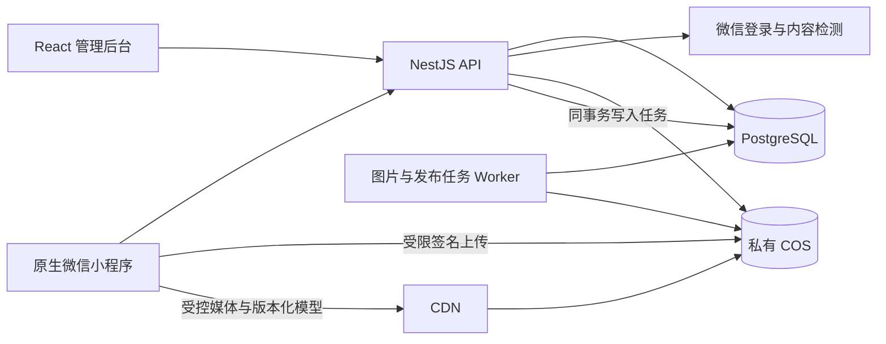

# LIVERSE 观演视野小程序技术方案

> 当前 Demo 的产品范围以[上海首版 Demo 产品设计](demo-product-design.md)为准：上海单馆、1F按场次绑定布局、2F固定座位、同页操作及3D模式占位。本文保留为原技术基线，相关数据关系和页面拆分需在后续实施时调整；本次未改动工程或引入3D模型。

版本：v0.1；日期：2026-10-26；状态：技术实施基线，工程尚未搭建。

产品依据：[产品设计文档 v0.2](product-design.md)。首发场馆为北京 LIVERSE，取代早期苏州试点建议；暂定同馆不同场次座位布局不变。本文确定实现结构，不填入未确认的场馆尺寸、座位编号或云服务账号。

## 1. 技术决策与边界

| 层次 | 采用方案 | 说明 |
|---|---|---|
| 小程序 | 微信原生、TypeScript、WXML、WXSS | Page／Component，直接调用微信导航、认证、上传与分享能力 |
| 2D 地图 | 小程序 Canvas 2D | 连续绘制座位与区域；筛选、详情和工具使用原生组件 |
| 3D 场馆 | Three.js、小程序 Canvas WebGL 适配层 | 适配库待真机试验后选择，不假定浏览器代码直接可用 |
| 场馆资产 | Blender、GLB/glTF、JSON 清单 | 建筑与座位数据分离；首轮 GLB 不启用需要额外解码器的压缩扩展 |
| API | NestJS、TypeScript、REST、OpenAPI | 模块化单体，公开、用户和运营接口分离 |
| 数据持久化 | PostgreSQL、Prisma | 关系约束、事务、索引和可审查迁移 |
| 异步处理 | 同一 API 代码库的独立 Worker、PostgreSQL 任务表 | 图片校验与转换使用 Sharp；任务带重试和租约，不阻塞 HTTP 请求 |
| 对象与分发 | 腾讯云 COS、CDN | 私有原图与派生图；公开模型使用不可变资源版本 |
| 运营后台 | React、TypeScript、Vite、Ant Design | 表格、审核、布局预览、工单和角色管理 |
| 工程管理 | pnpm workspace、Node.js 24 LTS、TypeScript strict | 共用契约与校验，不在小程序引入 Node.js 服务端依赖 |
| 部署 | Docker、腾讯云托管容器服务、托管 PostgreSQL | API 和 Worker 独立进程，独立健康检查；具体服务规格按验证和容量确定 |
| 自动验证 | Node.js test runner、Vitest、Supertest、Playwright | 文档、纯逻辑、接口与后台端到端；小程序补微信工具及真机测试 |

目前不引入微服务、Kubernetes、Redis、消息中间件或跨端 UI 框架。只有负载、任务延迟或限流吞吐实测证明需要时再扩展，保持首期部署与排障成本可控。

Node.js 24 为基线，其他依赖的精确版本在工程初始化时核查维护状态、安全公告、许可证和兼容性后锁定。提交 `pnpm-lock.yaml`，CI 使用冻结锁文件安装；Three.js 与适配层成对固定版本，禁止静默升级。当前未核查具体适配库，本文不宣称已完成技术验证。

## 2. 系统结构



API 负责身份、数据授权、业务事务与签名；Worker 负责解码、元数据清理、缩略图、外部检测及缓存失效任务；数据库保存状态和任务；对象存储保存二进制。小程序不接触数据库和云服务永久密钥。

后台与 API 尽量同源部署，通过网关将 `/api/` 转发到 API，其他路径提供后台静态资源。公开布局与模型可经 CDN 缓存，个人接口、待审内容和管理接口禁止公共缓存。

## 3. 仓库与构建

以下目录为待创建的目标结构；本次只交付文档。

```text
apps/
  miniprogram/               原生页面、组件、页面状态和微信能力封装
  api/                      NestJS 模块、Prisma schema／迁移、Worker 入口
  admin/                    React 管理后台
packages/
  contracts/                DTO、错误码、JSON Schema 和共享枚举
  venue-core/               位置标识、坐标转换、相机参数等纯计算
  venue-renderer/           Three.js 场景与独立平台适配接口
assets/
  venue-source/             可纳入版本管理的模型源文件或来源清单
  manifests/                版本清单、资源摘要和资产发布记录
fixtures/                   仅开发／测试可导入的示例布局
infra/                      Dockerfile、环境模板、部署与恢复说明
docs/                       产品、技术、接口与验证记录
tests/                      现有文档测试和跨模块测试
```

小程序 TypeScript 使用脚本构建：`tsc` 检查类型，`esbuild` 将逻辑及 workspace 依赖编译为适用于小程序的 JavaScript，并复制 WXML／WXSS／JSON。输出至被忽略的构建目录，开发者工具打开输出工程。不混用开发者工具二次 TS 转译；完整编译链在 M1 验证。

主包只包含首页、实拍、我的和基础组件；地图／3D 放按需分包。共享逻辑通过构建打包，不在运行时使用 workspace 路径。首次构建核对微信当时有效的包体与分包规则、基础库要求及工具版本，再决定资源分包位置。

`contracts` 与 `venue-core` 保持无平台依赖；共享校验以 JSON Schema 为契约，客户端与 NestJS 用兼容的编译校验器执行。NestJS／Prisma／Sharp 等仅出现在服务端。后台可用 OpenAPI 生成 API 类型，生成结果和契约一致性纳入 CI。

## 4. 小程序结构与状态

页面采用产品文档的「看座／实拍／我的」三个 Tab；地图、预览、对比、投稿及工单为独立页面。组件仅负责展示与交互，业务服务负责请求和状态转换，微信能力集中封装以便测试。

- 页面状态：当前楼层、选中位置、缩放、筛选与滚动位置；通过轻量领域 store 保存跨页状态，不先引入大型状态框架。
- 本机状态：游客收藏、最近浏览、可恢复的地图位置，保存 schema 版本并支持迁移；与账号缓存分区。
- 服务端状态：用户收藏、投稿、审核、工单；由 API 权威判断，不以客户端布尔值充当登录或审核依据。
- 3D 对象：场景、几何、纹理、相机与帧循环留在渲染实例，不通过 `setData` 传输；只同步必要的选中信息与加载状态。
- 请求封装：明确超时、取消、错误码和请求 ID；GET 可有限重试，写操作仅在幂等协议下重试。切换位置后丢弃过期请求结果。
- 登录恢复：记录待执行动作与账号上下文；按产品身份矩阵决定自动恢复一次有用标记或返回投稿确认，不能登录后直接重复提交表单。

开发、体验、正式三个环境分别配置 API、资源域名与功能开关。正式构建禁止导入 `fixtures/`；CI 检查入口依赖和资源清单中的示例标记。正式配置缺失时构建失败，不回退到模拟登录或示例模型。

## 5. 场馆数据与 2D／3D 一致性

### 5.1 唯一位置数据

北京首版共用标准布局，场次记录演出与日期用于内容筛选。保留布局版本服务于纠错与历史追踪，不按场次复制座位。座位布局固定不等于舞台和临时设备固定，未知演出配置显示标准参考。

位置引用统一包含 `venueId`、`layoutVersionId` 和位置类型。精确座位包含 `seatId`，区域参考包含 `sectionId`／`viewpointId`；不得用一个字符串混淆三种精度。票面 `rowLabel`、`seatLabel` 用字符串保留字母、前导零和编号方向。

同一套来源生成：数据库座位记录、2D 布局 JSON、3D 实例变换及相机位置。发布校验 ID 唯一、楼层区域归属、有效有限坐标、资源引用与数量一致；不能由前端临时按排号推测真实坐标。

### 5.2 坐标与模型规范

统一采用右手坐标系、米为单位、Y 轴向上；X 轴沿舞台左右，Z 轴由舞台指向观众。原点为约定的舞台中心地面参考点，地面标高与舞台台面高度分别记录，朝向以明确的旋转单位存储。该规范是待资产制作遵循的技术约定，不是现场测量结果。

2D 由 X／Z 投影，并保存从世界坐标到画布的矩阵；触摸命中使用逆矩阵处理缩放、平移及旋转。不得分别在地图和模型中手工镜像坐标。座位坐标定义为地面上的座位中心，坐／站姿眼高由相机参数叠加，避免重复叠加坐垫或层高。

Blender 导出时统一单位、应用变换并验证 glTF 轴转换；用已知方向标记检查左右、舞台方向和楼层。建筑模型中区分总览可隐藏部件与视线遮挡部件，进入观众视角不得错误隐藏栏杆、立柱或挑台。

### 5.3 资源清单

每个发布版本包含 `schemaVersion`、`layoutVersionId`、来源与核验状态、坐标约定、资料能力、区域／座位数据、相机预设、模型与图片资源清单。资源记录内容摘要、字节数、格式及不可变对象 key，客户端校验版本和关键摘要。

大模型不通过业务接口内嵌，不长期放在小程序包体中。客户端只缓存当前使用版本并设置容量上限与清理策略；可变的「当前版本」指针短缓存，不可变资源可长缓存。每次打开仍校验版本发布状态，已下架资源停止签发访问；已下载到用户设备的内容不能承诺远程彻底擦除。

## 6. 渲染实现与真机技术关卡

### 6.1 2D

Canvas 只绘制可见楼层与视口内对象，按缩放等级显示区域、座椅和文字。使用空间索引缩小点击候选，不逐帧扫描全部座位。触摸事件区分单击与拖动；密集区域先放大再选座，详情通过原生面板展示。

逻辑尺寸与设备像素尺寸分离，按 DPR 绘制并设置合理上限。布局几何、坐标变换、命中和选择是纯计算，可在 Node.js 测试；手势与页面滚动冲突仍需微信真机验证。

### 6.2 3D

Three.js 负责场景、相机、Raycaster 和 `InstancedMesh`；座椅批量实例化，选中颜色或单独标记反馈。大型实例按楼层／区域分组以便裁剪和拾取；性能测试评估 Raycaster 成本，必要时先按区域缩小候选。

渲染器对业务暴露加载、选择位置、切换总览／观众视角、复位、暂停、恢复、截图与销毁方法。平台适配集中处理 Canvas、触摸、资源加载、定时器和图片解码，不在全局修改浏览器对象来掩盖兼容问题。

首期采用简单材质、预计算灯光或基础照明，限制透明面、动态阴影、纹理尺寸和 DPR；画质分档由真机数据决定。一个对比页默认只运行一个渲染器，A／B 使用相同画幅、FOV、眼高和目标，普通实拍不伪装为统一尺度。

生命周期：页面隐藏暂停帧循环；退出取消网络与事件，释放几何、材质、纹理、渲染器及引用。异步资源晚到时确认页面仍存活，否则立即释放。上下文丢失后可重建，失败返回 2D 或已核实参考图，保留位置。

### 6.3 前置验证

工程初期先用示例场景做原生 Canvas WebGL 真机试验，再选择具体适配依赖。验证模型加载、点选、触摸、截图、前后台恢复、连续进出 20 次及负载递增；记录座椅实例数、资源量、draw call、帧耗时与可获得的内存指标。

至少覆盖 iOS、主流安卓、较低配置安卓，并记录型号、系统、微信和基础库版本。初始指标沿用产品文档：中档环顾平均至少 30 FPS、3D 首帧 P95 不超过 5 秒等；实验记录须同时报告长帧与失败，不能只报告平均值。具体适配库、最低支持版本与画质档位按报告锁定。

技术关卡通过才批量建设依赖该渲染方案的页面与资产；原生页面和 2D 可并行。简单模型通过不等于最终模型通过，真实资产到位后必须复测。无法达到目标时先优化／更换适配，改用 H5 承载 3D 需重新评审。

## 7. 后端模块与数据约束

| 模块 ID | 模块 | 产品需求 ID | 主要职责 |
|---|---|---|---|
| MOD-01 | Venue／Layout | FR-01、FR-02、FR-03 | 标准布局、位置查询、发布指针、资料能力与版本 |
| MOD-02 | View／Favorite | FR-04、FR-05 | 对比契约、收藏幂等、导入与公开分享定位 |
| MOD-03 | Content／Media | FR-06、FR-08 | 官方和用户内容、上传处理、审核状态及访问控制 |
| MOD-04 | Auth／Account | FR-07、FR-09 | 微信会话、账号隔离、资料和删除申请 |
| MOD-05 | Feedback／Report | FR-09 | 工单归属、回复、举报与紧急联系配置 |
| MOD-06 | Admin／Audit | FR-10 | 运营身份、RBAC、发布／审核留痕及统计 |
| MOD-07 | Health／Recovery | FR-11 | 健康状态、故障分类、能力开关与恢复所需接口 |

数据表围绕 Venue、LayoutVersion、Section、Seat、Viewpoint、Event、User、Session、Favorite、Contribution、Media、ContributionMedia、Helpful、Ticket、TicketReply、Admin、Role、AuditLog、Job／Outbox 组织。

- 布局版本、区域、座位用外键及复合约束校验同一归属；投稿关联场次时同样验证场馆一致，不只检查 ID 是否存在。
- Favorite 对用户、布局版本和位置建立唯一约束；Helpful 对用户与投稿唯一。重复请求返回当前状态，而非重复插入。
- 投稿区分精确座位、区域与场馆范围，通过数据库 CHECK／复合外键及服务校验保证字段组合；Prisma 无法表达的约束写入审查过的 SQL 迁移。
- 图片归属投稿或官方资料，删除前检查引用；首期不开放任意跨投稿复用，避免一处删除影响他人内容。
- 使用 UTC 时间戳，场次另存当地日期与 `Asia/Shanghai` 时区。上传日期不能替代演出日期，座位号不可转换为数值排序依据。
- 列表按 `createdAt + id` 等稳定顺序游标分页；对发布状态、位置、场次、审核队列建立按真实查询验证的索引。

布局发布在事务中校验并更新当前版本指针，历史已发布内容不可原地改写；修正生成新版本。撤下版本优先阻止 API 与媒体访问，再执行缓存失效；不把版本回退等同于数据库整体恢复。

## 8. API、认证与幂等

### 8.1 接口约定

所有业务接口使用 `/api/v1/`，JSON 请求和响应、显式分页、OpenAPI 描述。错误包含稳定 `code`、可读消息、`requestId` 和可选重试信息，不返回堆栈。大资源通过签名资源地址获取，列表仅返回必要缩略图信息。

| 接口分组 | 示例职责 | 访问要求 |
|---|---|---|
| `/venues`、`/layouts`、`/positions` | 当前标准布局、位置查找、能力及版本状态 | 公开但只返回已发布资料 |
| `/contributions` | 已公开实拍与详情 | 公开；待审和已撤下内容不可枚举读取 |
| `/auth/wechat`、`/auth/refresh`、`/auth/logout` | 会话建立、轮换、撤销 | 服务端校验；限制调用频率 |
| `/me/favorites`、`/me/contributions`、`/me/tickets` | 个人记录及操作 | 用户会话与对象归属校验 |
| `/uploads`、`/contributions/:id/helpful`、`/reports` | 上传授权与确认、有用标记、举报 | 用户会话、幂等与限流 |
| `/admin/*` | 草稿、发布、审核、工单、角色与统计 | 独立运营会话、RBAC 与审计 |

具体 URL 和 DTO 在工程中按上述分组细化；接口示例不代表已实现服务。客户端遇到 401 按产品规则恢复任务，遇到 409／410 区分版本冲突与内容失效，429 使用退避，不无限重试。

### 8.2 身份

微信 `wx.login` 的临时 code 交由后端换取微信身份，以 AppID 和 OpenID 唯一映射用户；UnionID 只在合法取得时作为额外关联信息。不把 OpenID、昵称或客户端上传的用户 ID 当成会话凭据；AppSecret 和微信 session_key 仅留服务端安全边界内。

小程序使用随机不透明访问／刷新凭据，数据库只存摘要与到期状态。初始建议访问凭据 30 分钟、刷新凭据 7 天，使用后轮换刷新凭据并检测重复使用；可撤销、可退出所有设备。参数为工程配置，发布前与安全测试一起确认；不得记录原始令牌。

后台首期采用系统管理员预置的运营账号，密码用 Argon2id 摘要、支持 TOTP 二次验证与恢复码；禁止默认密码，首个账号通过一次性运维命令建立。会话使用 HttpOnly／Secure／SameSite Cookie，并校验 Origin 和 CSRF token。无 SSO 假设，后续如有客户企业身份源再接入。

### 8.3 写操作

投稿等创建操作要求 `Idempotency-Key`，按用户＋操作＋key 唯一，保存请求摘要及结果；同 key 不同参数返回冲突。收藏与有用标记使用显式设置／取消操作，避免网络重试把 toggle 执行两次。

数据库状态变更与 Job／Outbox 写入同一事务。Worker 采用 PostgreSQL 行锁与 `SKIP LOCKED` 领取任务，带租约、心跳、有限指数退避和失败队列；处理至少一次，因此图片产物、外部回调和审核动作均要幂等。租约过期可重领，不能因容器重启丢失任务。

## 9. 图片、审核与下架

上传流程：创建上传任务 → 获得限时、限定对象 key 与上传条件的签名 → 直传私有 COS → 提交完成确认 → Worker 校验并重新编码 → 检测与人工审核 → 事务发布内容 → 按访问规则提供缩略图／大图。

服务端核对对象归属、实际体积、魔数、可解码性、像素数量和图片数量；不信任客户端 MIME、扩展名和元数据。按产品的 4 张、单张原图 20 MB 等规则校验，并设置解码像素上限和任务时间／内存限制。Sharp 重新编码去 EXIF／GPS，规范化方向并生成尺寸固定的缩略图；不能承诺自动消除画面中的隐私。

任务未完成、外部检测未知或人工待审时均不公开；微信内容安全检测按正式类目与接口可用性接入，人工审核保留。审核正文、图片、署名与位置，状态变更检查版本，防止旧审核请求覆盖删除或下架。

COS 不提供用户原图的永久公开地址。待审／个人内容需归属校验，已公开内容也先确认发布状态后签发短期 CDN／源站访问地址；缓存 key 使用内容版本和处理版本，签名 query 与缓存策略需专项验证。

初始下架时限目标：数据库下架提交后停止签发；既有签名最长 60 秒有效（下载启动与连接持续时间须在联调中验证），同时清理 CDN 缓存；源站仅允许受控 CDN／签名访问，关闭备用公开域名和直链。网关或 CDN 不具备相应能力时不能宣称立即失效，发布前选定可满足时限的配置或逐请求媒体授权代理。已下载或另存的图片不能追回，隐私政策如实说明。

未关联原图设置短期清理任务；生产库中的授权、处理结果、原图保留期和删除工单应有一致生命周期。具体保留期由运营确认，未确认前不启用无限期原图留存。

## 10. 运维、部署与成本

本地开发可用 Docker Compose 提供 PostgreSQL，API／Worker／后台独立启动。开发上传使用隔离测试桶或本地存储适配器，不写入生产桶；真实微信登录只使用合法配置，测试通过明确标识的测试适配器注入身份，正式构建禁用。

生产在同一地域私网连接托管 PostgreSQL，API 与 Worker 使用独立容器入口、资源配额和服务身份。API 无状态，可横向扩容；图片在 COS，任务在数据库，容器磁盘只用于有界临时处理。初始实例数、数据库规格、并发数与带宽在压测及预算确认后配置，不在文档编造容量。

用结构化日志、请求 ID、错误跟踪与必要指标监控：HTTP 错误／延迟、数据库连接、任务积压与失败、图片处理、签名与缓存失效、审核积压、3D 加载失败与产品指标。凭据、原始工单文字、原图及原始搜索词不进入日志／埋点。告警分配具体责任人，上线前完成一次触发演练。

正式配置的秘密通过云密钥管理或受控部署变量注入；数据库密码、AppSecret、COS 凭据、小程序上传密钥不进 Git。最小权限服务账号仅能访问各自资源前缀。费用重点跟踪图片与模型出网、存储、图片处理资源、数据库及日志，设置预算告警，限制恶意上传与签名请求。

数据库使用自动备份及可用的时间点恢复，对象存储采用版本／生命周期策略；异地策略、RPO、RTO、保留期和负责人在上线前确认并恢复演练。恢复数据库后先核对删除／下架审计再启用媒体签发，防止已删除内容因备份恢复重新公开。

## 11. 测试、CI 与发布

| 技术验证 ID | 产品验收 ID | 验证内容 |
|---|---|---|
| TV-01 | AC-01、AC-02、AC-05 | 共享坐标、ID、版本、命中与查找；布局导入校验；收藏去重与分享还原 |
| TV-02 | AC-03、AC-04、AC-11 | 微信真机 2D／3D、基准比较、截图、上下文恢复、降级、内存与最终模型复测 |
| TV-03 | AC-06、AC-08、AC-12 | 上传伪装文件／像素超限／重复确认、审核状态、授权、图片下架与官方内容覆盖 |
| TV-04 | AC-07、AC-09 | 登录轮换、过期与换号、横向越权、工单隐私、删除申请与任务恢复 |
| TV-05 | AC-10、AC-13 | 后台权限、并发审核、发布回退、审计、指标分类、测试流量排除与敏感字段检查 |

沿用现有文档测试。纯逻辑采用 Vitest；NestJS 用 Vitest 与 Supertest，集成测试连接独立 PostgreSQL 并运行真实迁移，不能用 SQLite 替代数据库约束验证。后台用 Playwright 验证审核和发布关键路径；小程序使用微信开发者工具及在其支持范围内的自动化工具检查导航与状态，GPU、权限及真机生命周期由设备测试补齐。

CI：冻结安装 → lint／类型检查 → 文档与单元测试 → 数据库集成／权限测试 → 后台 E2E → 三端构建 → 依赖与秘密扫描 → 正式产物无示例资产检查。实际门禁在相应工程创建时落地；本次只能运行现有文档测试，不报告尚未建立的功能测试通过。

GitHub Actions 生成可追溯到 commit 的镜像及静态产物；部署使用受保护环境和最小权限云凭证，未配置身份联邦时使用可轮换的受限密钥。小程序 CI 上传使用单独管理的微信 CI 密钥，体验版上传、审核和正式发布分开，提交代码不自动发布生产。

数据库迁移采用可兼容的新增字段／表先行，API 兼容已发布小程序版本；破坏性删除等旧客户端退出支持期再执行。部署时串行执行迁移并验证健康检查，业务容器不各自抢跑迁移。回退应用到上一已验证镜像，布局回退当前版本指针；迁移和媒体删除不能假定可用一次 Git 回退恢复。

## 12. 实施步骤与待补输入

| 阶段 | 工程交付 | 验收边界 |
|---|---|---|
| T0 工程初始化 | workspace、编译、原生路由、契约、CI 和隔离示例 | 编译／测试可重复；不创建虚假正式数据 |
| T1 2D 与 3D 技术关卡 | 共享坐标、Canvas 交互、候选适配层和真机报告 | 锁定适配版本、设备支持与性能分档，再扩展场景 |
| T2 交付包 A | 标准布局、官方素材后台、本机收藏、对比和分享 | 用示例验证业务；真实逐座能力须待资料与校准签核 |
| T3 交付包 B | 微信认证、云收藏、投稿、审核、工单和运营权限 | 接口／安全／弱网／状态及媒体下架测试通过 |
| T4 正式发布准备 | 真实资产复测、域名、主体、备份恢复与值守 | 满足产品上线门槛；云资源部署和公开发布另行执行 |

仍需输入：客户主体与 AppID、微信管理员和 CI 授权、正式域名及备案、腾讯云账号与预算、运营人员和处理期限、备份恢复目标，以及产品文档中留空的北京场馆资料。

不依赖这些输入即可搭建工程、运行本地示例与单元测试；真实微信登录、云资源联调与真机预览分别受 AppID、授权和设备条件约束。当前未创建云资源、安装依赖或初始化应用，也未完成任何性能／准确性实测。

## 13. 维护依据

- [产品设计文档](product-design.md)：功能、身份矩阵、A／B 交付包、指标及资料空表的依据。
- [项目协作规则](../AGENTS.md)：改动后更新相关测试、验证通过并创建对应 commit。
- [历史 UI 方案](../output/ui/LIVERSE_座位视野模拟器_UI设计方案.md)：视觉和交互参考；北京首发以当前产品文档为准。

| 版本 | 日期 | 变更 |
|---|---|---|
| v0.1 | 2026-10-26 | 确定原生小程序、Three.js、NestJS、PostgreSQL、React、腾讯云技术栈及工程实施规则 |
